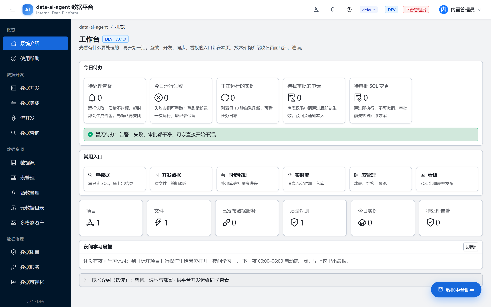
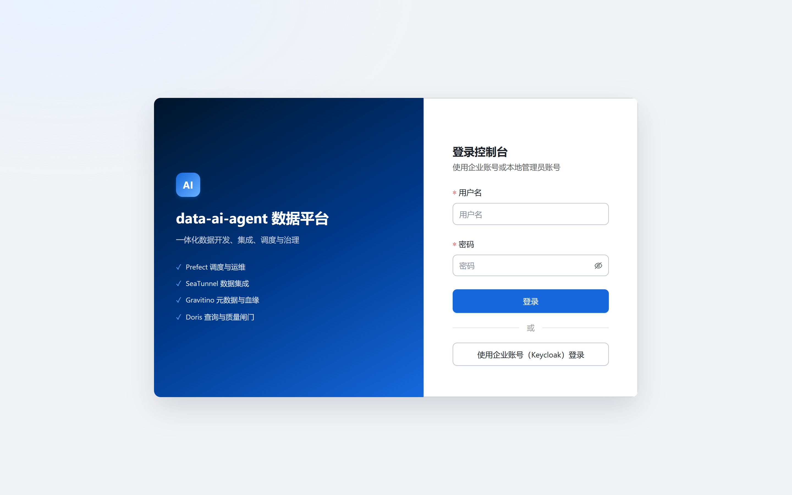
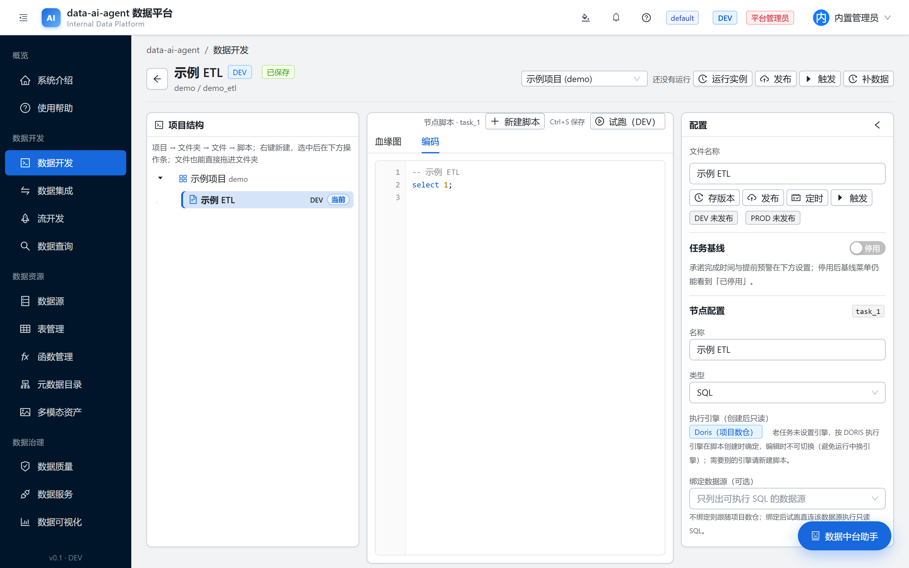
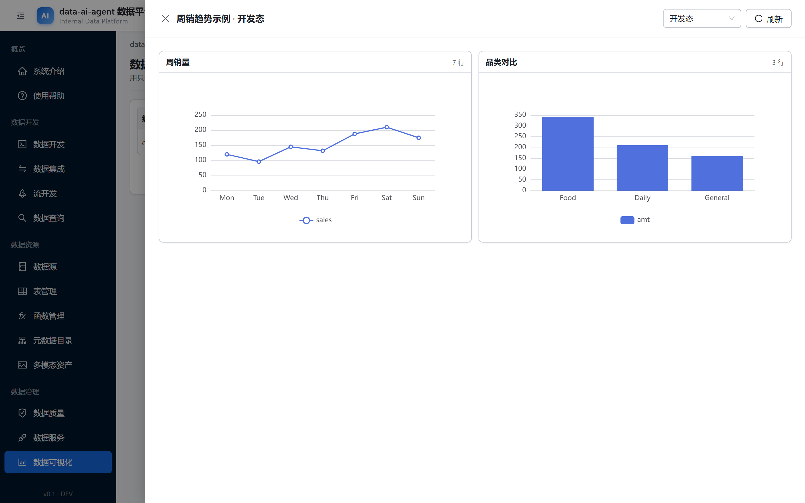
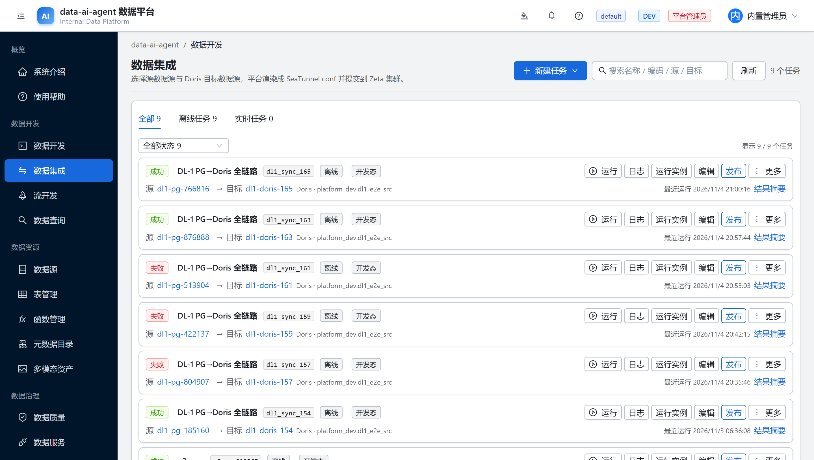
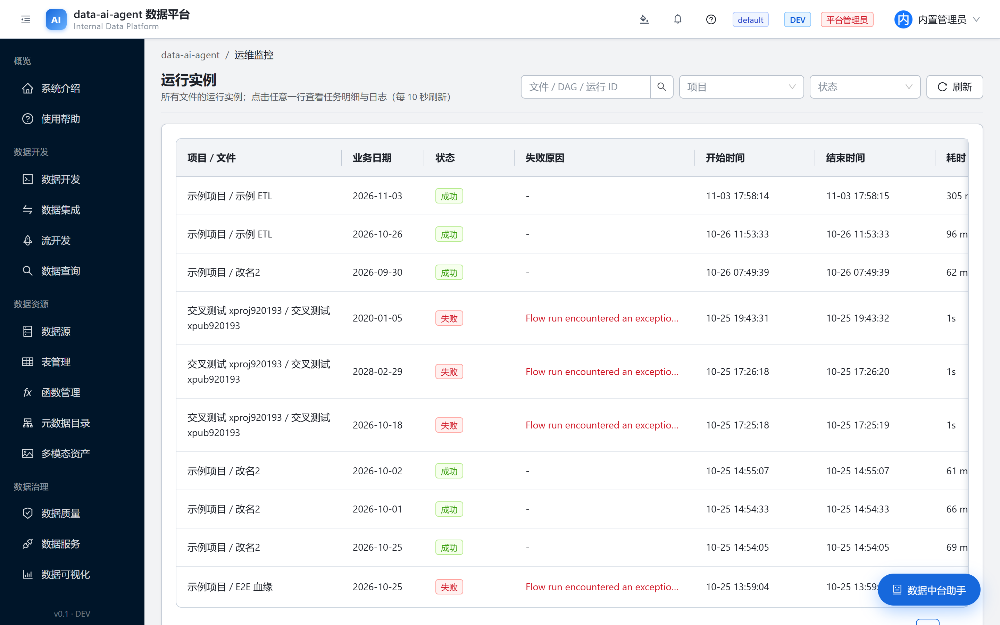
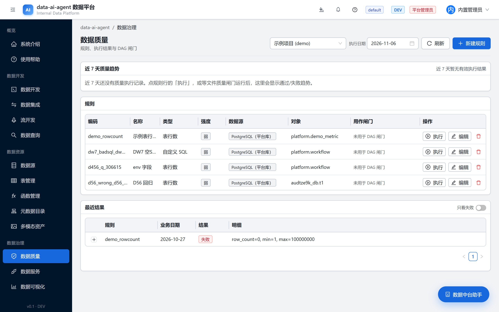

# dataworks-ai

<p align="center">
  <a href="LICENSE"></a>
  <a href="README.md"></a>
  
  
</p>

> **一台机器、一条命令就能看见界面的自托管数据平台**——数据集成（批 + CDC）、数据开发、
> 调度、数据质量、数据服务、可视化 BI、FlinkSQL 流开发，Spring Boot 后端 + React 前端。
> **演示形态单机一键起，完整形态三节点一键铺。**两种形态都不藏前置条件。

<p align="center">
  
</p>

## 30 秒上手（演示形态 · 一条命令）

敲之前必须满足：Docker ≥ 24 + compose v2.24+；内存整机 ≥ 12 GB（8 GB 能跑但紧）；
磁盘留 ≥ 30 GB。本机不用装 Java/Node——都在容器里编译。

```bash
git clone <本仓地址> && cd <本仓>/deploy/compose
bash up.sh        # 首次：拉 6~8 GB 镜像 + 容器内编译，约 10~20 分钟
```

构建结束会打印**一次性 `admin` 口令——立刻复制**；浏览器打开
**http://localhost:30090**，用 `admin` + 该口令登录，看到的就是上面那张主视图。
命令行验证：

```bash
curl -s http://localhost:30090/api/health   # {"status":"UP","db":"UP","schemaVersion":"..."}
```

要调度 / CDC / Flink / 数据地图？它们在完整形态里，见下方「先按机器选形态」。
停止演示：`bash down.sh`。

## 关键数字

| 项目 | 数字 |
|---|---|
| 许可证 | MIT（OSI 认可，全文见 [LICENSE](LICENSE)） |
| 演示部署 | 1 条命令 / 6 容器 / 首次构建 10-20 分钟 / **1 台机器** |
| 完整平台 | **1 个 k3s 集群（3 节点）** / 集群内 28 个工作负载 / Ansible 离线包引导 |
| 后端 | 500+ REST 接口，Java 17 + Spring Boot |
| 前端 | React + Vite 单页应用（批开发 / 流开发 / 运维看板） |
| 测试面 | `scripts/e2e/` 240+ 端到端审计脚本 |
| 治理 | 权限点 × 可配角色 RBAC、多租户隔离、L1-L4 分级 + 列级脱敏 |
| 引擎 | Doris 数仓、SeaTunnel 集成、Flink 1.20 SQL 流、Prefect 3 调度、Kafka、Spark、Keycloak SSO |

## 系统截图

全部为真实运行界面直出，无摆拍无素材图；每张图注标出来自哪种形态。
抓取方式可复现：[`scripts/ci/readme-shots/`](scripts/ci/readme-shots)
（Playwright 直连活环境逐页渲染截图，机器可读台账在 `assets/capture-manifest.json`）。

### 登录页 —— 首次启动即接好 Keycloak SSO（演示形态）



### 主视图 —— 项目、待办、模块入口（演示形态）


### 数据开发 —— 项目树 / 编辑器 / 结果三栏（演示形态）



### 可视化 BI —— 只读 SQL 经 DEV 冒烟后出 ECharts 图（演示形态）



### 数据集成 —— SeaTunnel 批 + CDC 任务列表（完整形态）



### 调度 —— Prefect 运行实例，成败与原因可见（完整形态）



### 数据质量 —— 规则表挂资产，带告警（完整形态）



## 先按手上的机器选形态

第一个问题先直答：**一台 8G 服务器跑不了全套**——完整形态要 3 台节点、每台内存硬闸
≥ 7 GB（preflight 不够直接停）；8G 单机能跑的是**演示形态**，属于「能跑但紧」。

| 形态 | 实际得到什么 | 机器与资源（全是硬数字） | 怎么上去 |
|---|---|---|---|
| **A. 演示**（Docker Compose） | 登录 + 界面 + SQL 开发 + 数据服务 + BI；调度/CDC/Flink/数据地图没有，界面上会明说 | **1 台机器**；软件只要 Docker≥24 + compose v2.24+。六件套稳态实测 ≈2.8 GiB，首次构建峰值高数 GB——建议 ≥12 GB；磁盘留 ≥30 GB | 上方「30 秒上手」 |
| **B. 完整平台**（k3s · Ansible 离线包） | 全部能力：Prefect 调度、SeaTunnel 批+CDC、FlinkSQL、Gravitino 数据地图、Kafka、Spark、监控、助手/RAG | **3 节点 + 1 台 Linux 控制机**；节点硬闸 ≥7 GB，规划 6vCPU/12 GB/≥40 GB 盘 每台 | 清单 + 一条命令（下） |
| **C. 接管已有 K8s** | 同 B 的工作负载，不装节点 | 你的集群 + kubeconfig + 一个 StorageClass | `deploy.sh existing` |

形态 B 一条命令的诚实含义：**敲一条命令，跑几十分钟**——

```bash
cd deploy && bash deploy.sh install
# preflight → 节点基线 → k3s → 私有仓库 :30500 → 灌镜像 → 按序铺 28 个工作负载 → 验收
```

「那么多服务怎么一键」——因为**从来只有一个集群**：28 个工作负载全在这一个 k3s 里；
逐参数全文见 [deploy/README.md](deploy/README.md)，模块级文档在 [docs/](docs/)。

## 能力分区

- **数据集成**：SeaTunnel 批 + CDC，水位、失败原因、停止控制都在界面上；MySQL ≥ 8.4
  在创建任务时被本平台自身的版本探测拦下（400），这是平台校验，不是数据库通用行为。
- **数据开发**：项目级 SQL IDE + 树导航 + 版本与发布/下线生命周期；UDF 注册表把 jar
  同时下发 Doris 全局函数与 Flink 会话集群。
- **调度**：Prefect 3 DAG：定时、重跑、按上游选择补数；flow 文件自动同步集群。
- **质量与治理**：质量规则 + 告警、L1-L4 分级、列级脱敏查询网关（OFF/LOG/ENFORCE）、
  权限点 RBAC、by-id 接口租户隔离守卫。
- **数据服务**：SQL 发布成 REST API，Token 轮换、冒烟测试、开发/生产分离
  （发布快照冻结，试运行必须通过才能发布）。
- **BI 与助手**：参数化只读 SQL 出 ECharts 看板；内置中台助手带项目记忆与文档 RAG。
- **流开发**：Flink SQL 走会话集群 + SQL Gateway，作业状态实时在 `/stream`。

## 坑点（先说清再上手）

- SeaTunnel 连接器放节点 hostPath `/tmp/seatunnel-connectors`，系统清理 `/tmp` 会让
  新作业静默失败——处理见 [deploy/README.md](deploy/README.md)。
- 演示形态自带**本机默认凭据**，任何共享部署前先轮换；`.invalid` 端点保持原样，
  缺件请求不会打进任何人内网。
- 已知未修（如实）：演示形态里迁移内置的 Doris 数据源行带着集群内部 DNS 名，
  数据查询/BI 默认走到不可达主机——新建一个指向本机 `doris` 服务的自定义 Doris
  数据源即可（上方 BI 图就是这么截的）。修复排期内置数据迁移源头，不用文档糊弄。
- 单机端口在 compose/k3s 清单里钉死（Doris FE/BE、NodePort 30090），同机混部先改映射。
- 工作名 "dataworks" 与某云厂商注册产品重名，改名待上游统一决定，本快照按现名分发。

## 许可证

[MIT](LICENSE)。MIT 无 NOTICE 义务，本包不分发 NOTICE；第三方依赖各随其证。
