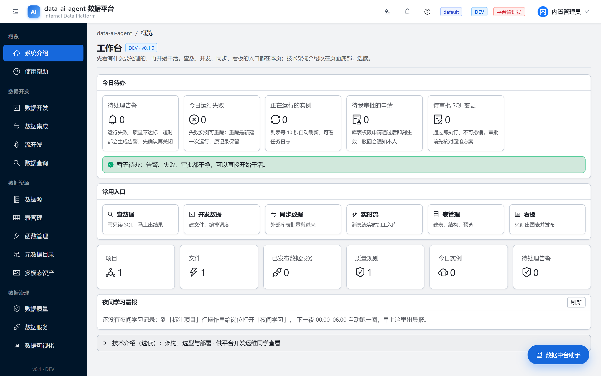
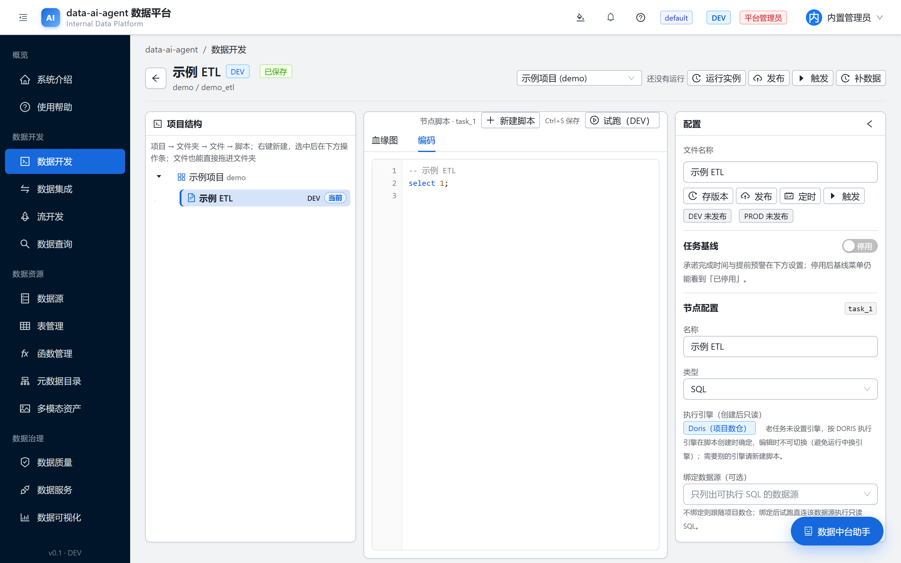
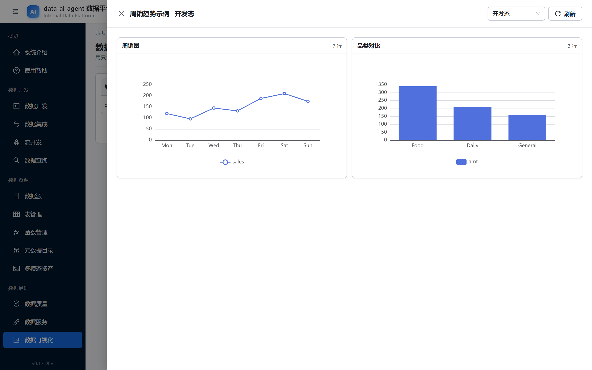
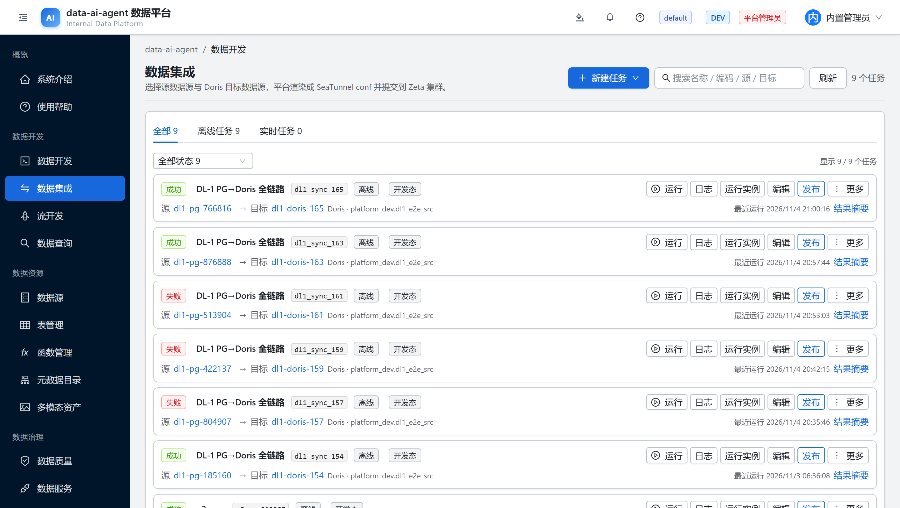
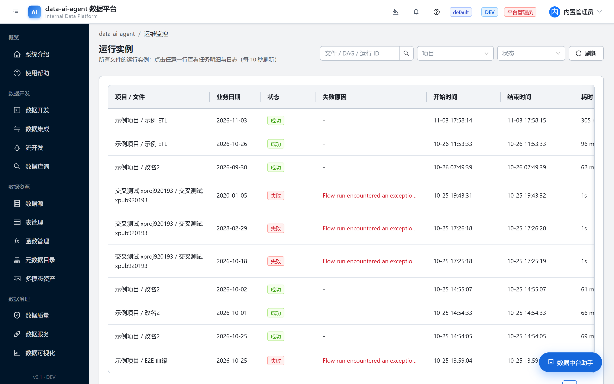
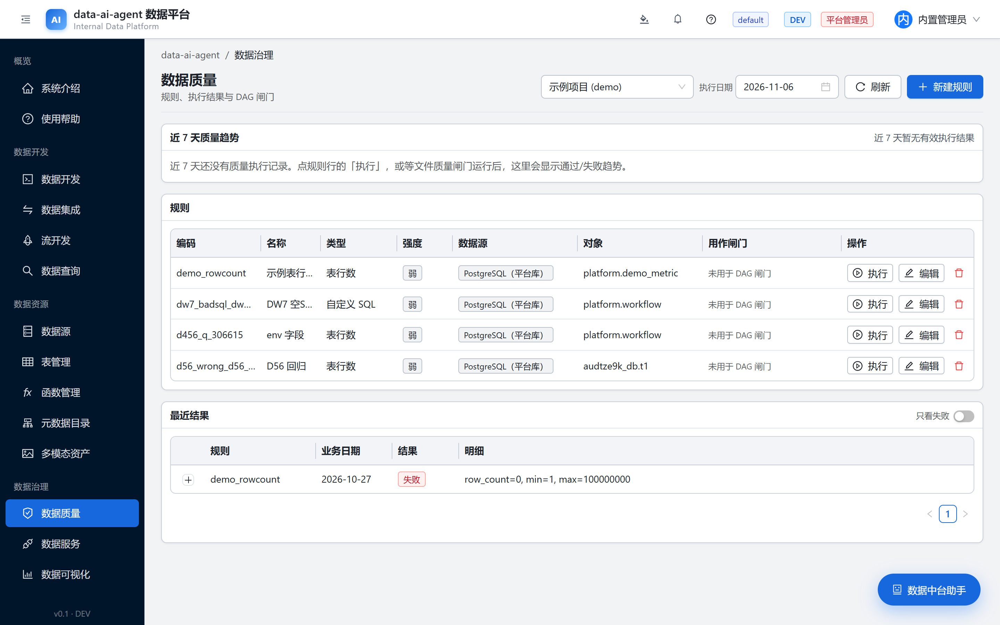

# dataworks-ai

<p align="center">
  <a href="LICENSE"></a>
  <a href="README-zh.md"></a>
  
  
</p>

> **A self-hosted data platform you can see within 30 minutes** -- batch + CDC ingestion,
> SQL development, scheduling, data quality, API serving, BI dashboards and Flink SQL
> streaming, Spring Boot + React. **One command runs the demo on a single machine; one
> command provisions the full platform on 3 nodes.** Neither shape hides its prerequisites.

<p align="center">
  
</p>

## Quick start (demo shape -- one command, then open your browser)

Prereqs BEFORE typing it: Docker >= 24 + compose v2.24+, >= 12 GB RAM (8 GB works but is
tight), >= 30 GB free disk. No Java/Node on the host -- both compile inside containers.

```bash
git clone https://github.com/<owner>/dataworks-ai && cd dataworks-ai/deploy/compose
bash up.sh        # first run: pull ~6-8 GB images + in-container builds, 10-20 min
```

End of build prints a **one-time `admin` password -- copy it immediately**; then open
**http://localhost:30090** and sign in as `admin`. That is the home screen above.
Verify from CLI:

```bash
curl -s http://localhost:30090/api/health   # {"status":"UP","db":"UP","schemaVersion":"..."}
```

Need scheduling / CDC / Flink / data-map? Those live in the full shape -- see
"Which way should I deploy?" below. Stop the demo with `bash down.sh`.

## Headline numbers

| What | How much |
|---|---|
| License | MIT, OSI-approved (full text in [LICENSE](LICENSE)) |
| Demo deploy | 1 command / 6 containers / 10-20 min first build / **1 machine** |
| Full platform | **1 k3s cluster (3 nodes)** / 28 workloads inside it / guided playbook |
| Backend | 500+ REST endpoints, Java 17 + Spring Boot |
| Frontend | React + Vite SPA (batch dev, stream dev, ops boards) |
| Test surface | 240+ end-to-end audit scripts in `scripts/e2e/` |
| Governance | RBAC permission atoms x configurable roles, multi-tenant isolation, L1-L4 classification + column masking |
| Engines | Doris warehouse, SeaTunnel ingestion, Flink 1.20 SQL streaming, Prefect 3 scheduling, Kafka, Spark, Keycloak SSO |

## Which way should I deploy? (answer it with your hardware)

Short answer to the question everyone asks first: **no, an 8 GB single server cannot run
the full platform** -- it needs 3 nodes at >= 7 GB each (a hard gate that fails fast,
not a suggestion). What an 8 GB box CAN run is the demo shape, tightly. Pick your row:

| Shape | What you actually get running | Machines & resources (all hard numbers) | How you get there |
|---|---|---|---|
| **A. Demo** -- Docker Compose | Login + UI + SQL development + data service + BI. Scheduling / CDC / Flink / data-map are absent and say so (`.invalid` endpoints, clear errors) | **1 machine**. Only software prereq: Docker >= 24 + compose v2.24+ (no Java/Node needed -- both compile in containers). RAM: measured idle stack of the six core services ≈ **2.8 GiB** (doris 1.76 + keycloak 0.61 + backend 0.36, rest < 0.3; `docker stats` after a 39 h run) but the **first build peaks several GB higher** -> >= 12 GB total advised; **8 GB works but is tight**; disk: ~6-8 GB of images + build cache, keep >= 30 GB free | one command (below) |
| **B. Full platform** -- k3s via Ansible offline package | Everything: Prefect scheduling, SeaTunnel batch/CDC, Flink SQL streaming, Gravitino data map, Kafka, Spark, Prometheus/Grafana, assistant + RAG | **3 nodes + 1 Linux control machine** (Windows can host it only as a VM). Node gate is enforced: **>= 7 GB RAM each** (`preflight` stops below 7000 MB); design plan **6 vCPU / 12 GB / >= 40 GB disk per node**. Plus the offline package (image tars + SeaTunnel artifacts ~489 MB) on the control machine | checklist + 1 command (below) |
| **C. Reuse your existing K8s** | Same workloads as B, no node provisioning | your cluster + `kubeconfig` + one `StorageClass` | `deploy.sh existing` |

### Shape A -- demo in one command (the Quick start above IS this row)

The typed command is the one from **Quick start**; what it stands up is 6 services (plus two one-shot init containers): postgres + keycloak +
s3(SeaweedFS) + doris + backend + web (MinIO public images retired -- rationale in
[deploy/compose/README.md](deploy/compose/README.md)). Stop: `bash down.sh`.
If it dies partway, the compose README troubleshooting section covers the three
real-world failure modes (Doris ulimits, hub auth timeouts, port collisions).

### Shape B -- full platform: prerequisites first, then the one command

Do these five in order; the playbook refuses to run until 1-3 are done and TELLS you
which item is missing (it never fails silently):

1. **Machines**: 3 nodes each >= 7 GB RAM (target 12 GB), >= 40 GB disk, reachable by
   SSH from --
2. **A control machine** running Linux/macOS with Ansible (this is where you type the
   command; Windows hosts cannot run Ansible natively. You never log into the nodes).
3. **The offline package**: copy the whole `deploy/` dir to the control machine
   (keys/inventory/secrets templates ride along, all gitignored); image tars via
   `DW_IMAGES` if stored elsewhere.
4. **Fill two files**: `inventory/lab.yml` (3 node IPs + SSH user) and
   `secrets/lab.yml` (**18 secrets, all required -- any missing = playbook stops and
   lists them**).
5. **Run it -- one command, tens of minutes** (this is what "one command" honestly means:
   one line typed, a whole pipeline run):

```bash
cd deploy && bash deploy.sh install
# preflight -> node baseline -> k3s -> private registry :30500 -> registry-load
# -> 28 workloads in manifest order -> keycloak -> agent-service -> verify
```

6. **Acceptance + two known loose ends** (not yet folded into the playbook -- run both,
   each un-skipped step breaks a named page):

```bash
bash scripts/ops/gravitino-init.sh          # else the data-map page 502s
bash scripts/ci/configure-flink-s3.sh all   # else UDF jars fail on Flink submit
bash deploy.sh verify                        # nodes Ready / /api/health / NodePorts
```

Real-run evidence: first full install finished 2026-10-24 with 26 Pods Running +
4 Completed and `/api/health` UP at `http://<node1>:30090`.

### "So many services -- how is that ONE command?"

Because there is **one cluster, not many clusters**. Postgres, Doris, Keycloak, Prefect,
Kafka, Flink, SeaTunnel jobs, MCP, embedding, Prometheus... are **28 workloads inside a
single 3-node k3s cluster** (one filename = one stage, applied in declared order); only
three things live outside Kubernetes on the hosts: HDFS (native 3-node), SeaTunnel
hostPath artifacts, and `agent-service` (systemd on node 1). Full flag-by-flag detail in
[deploy/README.md](deploy/README.md); module docs under [docs/](docs/).

## Screenshots

Real captures of the running UI -- no mockups, no stock art. Each caption states which
shape it was taken from; how they were produced is reproducible via
[`scripts/ci/readme-shots/`](scripts/ci/readme-shots) (Playwright against a live
environment, manifest in `assets/capture-manifest.json`).

### Login -- Keycloak SSO is wired from the first boot *(demo shape)*


### Home -- projects, todos, module entry *(demo shape)*


### SQL development -- project tree, editor, results in one pane *(demo shape)*



### BI dashboards -- read-only SQL becomes ECharts after a DEV smoke test *(demo shape)*



### Data integration -- SeaTunnel batch + CDC task list *(full shape)*



### Scheduling -- Prefect run instances with success/failure reasons *(full shape)*



### Data quality -- rule tables bound to assets, with alerting *(full shape)*



## Features

### Ingestion
Batch and CDC sync tasks built on SeaTunnel; watermarks, failure reasons and stop
control are surfaced in the UI. A version probe gates MySQL sources at task creation
(8.4+ removed the legacy replication statements, so >= 8.4 returns 400 -- this is our
platform's own check, not a database behavior).

### Development
Project-scoped SQL IDE with a tree navigator, versioning and publish/offline
lifecycle; UDF registry ships jars to Doris global functions or Flink session clusters.

### Scheduling
Prefect 3 based DAG scheduling: cron triggers, rerun and backfill with upstream
selection; flow files sync to the cluster.

### Quality & governance
Quality rules with alerting, L1-L4 data classification, per-column masking behind a
query gateway (OFF / LOG / ENFORCE), permission-atom RBAC and tenant isolation
guards on by-id endpoints.

### Data service
Publish SQL as REST APIs with token rotation, smoke tests and dev/prod separation
(a published snapshot is frozen; trial run must pass before publish).

### BI & assistant
ECharts dashboards bound to parameterized read-only SQL, plus a built-in assistant
with project memory and RAG over platform docs.

### Stream development
Flink SQL on session clusters through the Flink SQL Gateway, live job status on `/stream`.

## Pitfalls

- SeaTunnel connectors load from node hostPath `/tmp/seatunnel-connectors`; OS `/tmp`
  cleanup silently breaks new jobs -- see [deploy/README.md](deploy/README.md).
- The compose demo ships **local-only default credentials**; rotate them before any
  shared deployment, and keep `.invalid` endpoints as-is so stray requests never reach
  a real host.
- Known compose gap (open): the migration-seeded "built-in Doris" datasource row keeps
  a cluster-internal DNS name, so Data Query / BI fall back to an unreachable host on
  the demo shape -- create a custom Doris datasource pointing at the local `doris`
  service (the BI screenshot above was taken that way). Tracked upstream as a fix in
  the seed path, not a doc workaround.
- Single-node ports are pinned in compose/k3s manifests (Doris FE/BE, NodePort 30090);
  remap before co-hosting other stacks on the same box.
- The cluster (k3s/Ansible) form needs roughly 6c/12G per node plan; the compose demo
  is the low-footprint path.
- The working name "dataworks" collides with a registered Alibaba Cloud product;
  rename is pending an upstream owner ruling -- this snapshot ships under the name as-is.

More operational caveats: [deploy/compose/README.md](deploy/compose/README.md), [deploy/README.md](deploy/README.md), and the Chinese deep-dives under [docs/](docs/).

## License

MIT -- full text in [LICENSE](LICENSE). MIT carries no NOTICE obligation, so this
package ships without a NOTICE file. Third-party dependencies keep their own
licenses, distributed with each component (SBOM is tracked outside this card).

---

## 附录 · 中文细则

> 完整中文门面（徽章栏／真实截图节／30 秒上手）另见 **[README-zh.md](README-zh.md)**；
> 以下为既有中文说明原文下沉，口径不变；英文首屏是其摘要。许可口径 2026-11-05
> 起统一定为 MIT（取代旧统一口径）。

本仓库是**数据中台平台**，三分钟上手入口：

- **入口 A · 数据中台平台**（对标 DataWorks）：数据集成 / 数据开发 / 调度 / 质量 / 数据服务 / 可视化 BI。

### 入口 A · 数据中台平台：一条命令看界面

前提只有一个 **Docker**（Docker Desktop 或 docker engine + compose v2.24+）。
前后端在容器里编译，**本机不需要装 Java/Node**。

```bash
git clone <本仓> && cd <本仓>/deploy/compose
bash up.sh
# 首次：拉镜像 + 容器内编译前后端，约 10~20 分钟；结束打印一次性 admin 口令
```

浏览器打开 **http://localhost:30090**，用户名 `admin` + 打印的一次性口令登录。
命令行验证：

```bash
curl -s http://localhost:30090/api/health   # → {"status":"UP","db":"UP","schemaVersion":"..."}
```

六件套 = postgres + keycloak + s3(SeaweedFS) + doris + backend + web（单机演示形态；
MinIO 官方公有镜像与二进制已停发，替代原因见
[`deploy/compose/README.md`](deploy/compose/README.md)）。停止：`bash down.sh`。

#### 前置版本表

| 组件 | 版本 | 定版出处 | 说明 |
|---|---|---|---|
| Docker Engine | ≥ 24 | — | 演示形态唯一硬前提 |
| docker compose | v2.24+（`additional_contexts` 需要） | `docker compose version` | 旧版 compose 升级即可 |
| JDK | 17 | `backend/pom.xml` `java.version` | 仅本机改代码/跑 `mvn` 才需要；compose 构建容器内自带 |
| Maven | 3.9+ | 同上 | 容器内用 `maven:3.9-eclipse-temurin-17`，本机可 `mvn -s backend/settings.xml` |
| Node.js | 20 LTS | `web/`（Vite 5） | 仅本机前端开发才需要；容器内用 `node:20-alpine` |
| Python | ≥ 3.9 | `scripts/` | 仓库脚本与 e2e 审计件 |
| Kubernetes 形态 | k3s（Ansible 装） | [`deploy/README.md`](deploy/README.md) | 生产/集群形态走 Ansible 离线包，镜像仓库前缀 `dw_registry` 变量（默认私有仓库 30500，可 `-e dw_registry=` 覆盖） |

#### 最小依赖表（哪些件支撑哪些能力）

| 能力 | 需要件 | compose 演示 |
|---|---|---|
| 登录 / 看界面 / SQL 查询编排 | backend + postgres + web | ✅ |
| SSO 外部身份源（OIDC） | keycloak | ✅（自动建 realm `dataworks`） |
| 项目存储 / 多模态资产 | s3（SeaweedFS，S3 协议） | ✅（本机 demo 凭据） |
| 内置数仓 / 项目建库 | doris | ✅（自动建业务账号） |
| 调度（定时 / 重跑 / 补数） | Prefect 3 + bridge | ❌ 集群形态 |
| 数据集成批任务 | SeaTunnel | ❌ 集群形态 |
| FlinkSQL 流开发 | Flink 1.20 | ❌ 集群形态 |
| 数据地图 | Gravitino | ❌ 集群形态 |
| 监控 / 告警 | Prometheus + Alertmanager | ❌ 集群形态 |
| 中台助手 / RAG / 向量 | MCP + embedding + Prefect Bridge | ❌ 集群形态 |

演示栈未含件在界面里点开会明确报错（地址指向 `.invalid`，不会把请求发进任何人内网）。
集群/生产部署（k3s、私有仓库、Keycloak 主题、验收）：[`deploy/README.md`](deploy/README.md)；
模块级文档在 [`docs/`](docs/)。

### 入口 A · 先按你手上的机器选部署形态（再照该形态走）

第一个问题先直答：**「一台 8G 服务器能不能一键部署全套？」——不能。** 完整形态要
3 台节点、每台内存硬闸 ≥ 7GB（preflight 实测线，不够直接停）；8G 单机能跑的是**演示形态**，
而且属于「能跑但紧」。三种形态按机器选：

| 形态 | 你实际得到什么 | 机器与资源（全是硬数字，不是形容词） | 怎么上去 |
|---|---|---|---|
| **A. 演示**（Docker Compose） | 登录+界面+SQL 开发+数据服务+BI；调度/CDC/Flink/数据地图没有，界面上会明说 | **1 台机器**；软件只要 Docker≥24 + compose v2.24+（Java/Node 都在容器里编，本机不装）。内存：六件套稳态实测 **≈2.8 GiB**（doris 1.76 + keycloak 0.61 + backend 0.36，其余<0.3；39 小时连续运行后 `docker stats`，不含 e2e 临时叠加件），但**首次构建峰值高出几个 GB**——建议整机 ≥12GB，**8GB=能跑但紧**；磁盘：镜像 6~8GB+构建缓存，留 ≥30GB | 一条命令（上节） |
| **B. 完整平台**（k3s·Ansible 离线包） | 全部能力：Prefect 调度、SeaTunnel 批+CDC、FlinkSQL 流、Gravitino 数据地图、Kafka、Spark、监控、助手/RAG | **3 台节点 + 1 台 Linux 控制机**（Windows 主机只能开 VM 当控制机）。节点硬闸 **≥7GB**，规划口径 **6vCPU/12GB/≥40GB 盘 每台**；外加离线包（镜像 tar + SeaTunnel 件约 489MB）拷到控制机 | 前置清单+一条命令（下） |
| **C. 接管已有 K8s** | 同 B 的工作负载，不装节点 | 你的集群 + kubeconfig + 一个 StorageClass | `deploy.sh existing` |

**形态 B 的五步前置，缺一步 playbook 就停并点名缺哪项（不会静默失败）：**
① 3 台达标节点 → ② 1 台能跑 Ansible 的控制机 → ③ `deploy/` 整目录拷上控制机（离线包）→
④ 填两个文件：`inventory/lab.yml`（三节点 IP+SSH 用户）、`secrets/lab.yml`（**18 项密钥全填**）→
⑤ `bash deploy.sh install`——**「一键」的诚实含义：敲一条命令，跑几十分钟**
（preflight→node→k3s→私有仓库 30500→灌镜像→按文件名顺序铺 28 个工作负载→Keycloak→agent-service→验收）。

装完还有**两条尚未并入 playbook 的手工步**（如实报，跳过各坏一个页面，已挂 TODO 收编）：
`bash scripts/ops/gravitino-init.sh`（不跑=数据地图 502）、
`bash scripts/ci/configure-flink-s3.sh all`（不跑=UDF 提交报错）。
然后 `bash deploy.sh verify` 收口。实录背书：2026-10-24 首装完成 26 Pod Running+4 Completed、`/api/health` UP。

至于「那么多服务怎么一键」——因为**从来只有一个集群**：28 个工作负载全在这一个 k3s 里
（一个清单文件名=一段流程，按序 apply）；K8s 之外的只有三样主机级件（HDFS、SeaTunnel
hostPath 件、agent-service）。逐参数全文见 [`deploy/README.md`](deploy/README.md)。

### 入口 A · 许可证

本项目基于 [MIT 许可证](LICENSE) 授权。
MIT 全文见仓库根 `LICENSE`；MIT 无 NOTICE 义务，原 `NOTICE` 文件已随
2026-11-05 撤除。
第三方依赖各自的许可证随对应组件分发（源码文件头补许可证行属后续事项）。
